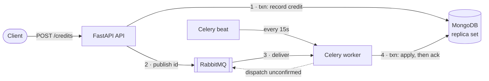

# Async Credit Processing Service: Design

## 1. Problem and goals

`POST /credits` takes a `user_id` and an `amount` and returns `202 Accepted` with a task id. A Celery worker adds the amount to the user's balance later, and a `status` field shows progress. Because this is money, the design has three goals: **an accepted credit is eventually applied, no credit is applied twice, and no cent is lost to rounding.** RabbitMQ only delivers at least once, so the design accepts that messages may be duplicated and makes each credit's effect idempotent. Each guarantee is tested against the failure it must survive (§6).

Assumptions: the user must already exist (otherwise `404`). Amounts are positive, at most 1,000,000.00, with at most 2 decimal places. There is a single currency. Clients authenticate with an API key; deciding which client may credit which user belongs to the real platform's identity model.

## 2. Architecture

| Component | Role and key settings |
|---|---|
| **API** (FastAPI) | Checks admission limits, records the credit, publishes and returns `202`. Handlers are synchronous because PyMongo and Celery publishing block; FastAPI runs them in its threadpool, so the event loop is never blocked. |
| **MongoDB** 8.2 | The source of truth, as a replica set (transactions need one). Majority-journaled writes and snapshot reads are pinned in code; every operation has a 10s timeout. |
| **RabbitMQ** | A durable queue with persistent messages and publisher confirms. Its ack and redelivery behaviour is explicit, which is why I chose it over Redis. |
| **Worker** (Celery) | `acks_late`, `reject_on_worker_lost`, `prefetch=1`, and a hard time limit: a message is only removed after the credit has committed. |
| **Beat** | Triggers the dispatcher every 15s; concurrent runs are safe. |

One codebase for all three processes; the business logic in `services.py` imports neither FastAPI nor Celery, so the API, worker and tests run the same code.

## 3. Data model

- **`users`**: `user_id` (unique), `balance` (Decimal128), `status`, `pending_credits`.
- **`credit_operations`**, one per credit and the authoritative status. It holds the request (`client_id`, `user_id`, `amount`, `idempotency_key` with a request fingerprint); its outcome (`status`, `processed_at`, `error`); processing fields (`attempts`, `crashes`, `in_flight_since`); and dispatch fields (`published_at`, `next_dispatch_at`, `dispatch_attempts`, a claim token).

A single `status` on the user can't describe two credits in flight at once. So the user's `status` is computed inside the transaction that settles a credit: `processing` while `pending_credits > 0`, otherwise the outcome of the last credit to finish. Money is a `Decimal` all the way through: a BSON codec stores it as `Decimal128`, and JSON carries it as strings.

## 4. Lifecycle

1. **Accept.** The API returns `503` if the queue backlog is above its limit, and `429` if the user already has 1,000 credits in flight; nothing is saved in either case. Then one transaction inserts the credit and increments `pending_credits` (an unknown user gets `404`). The API publishes **only the credit id**, which is also the Celery task id, waits for the broker to confirm it, and records `published_at`. If publishing fails, the credit is already saved, so the API still answers `202`. It then stops publishing for 5s, so that during an outage requests don't each wait on the broker.
2. **Apply.** One transaction moves the credit from `processing` to `processed`, **only if it is still `processing`**. It sets `balance = ifNull(balance, 0) + amount` (which creates the field) and decrements `pending_credits`. The worker acks the message after the commit.
3. **Dispatch.** The credit document doubles as the outbox, so there is no extra table or relay service. Each run claims due credits oldest-first in batches of 500, stamping each claim with a token and a 60s lease, and keeps going until nothing is due or 10s have passed. Credits that were **never confirmed by the broker** are published after a 10s grace period. Credits that were **confirmed but are still unprocessed after 15 minutes** are republished only while the queue is (nearly) drained. A deep queue means their message is almost certainly still waiting, and republishing would feed the backlog. If the broker fails mid-batch, the run records the credits already published, releases the rest and stops; the next run tries again.

## 5. Failure handling

| Failure | What happens |
|---|---|
| Worker commits, then dies before the ack | RabbitMQ redelivers the message; the guarded `processing → processed` step finds the credit settled, so nothing changes. |
| Commit reply lost (`UnknownTransactionCommitResult`) | `with_transaction` retries only the commit, never the whole transaction. If the outcome is still unknown, the worker retries the task and the guarded step makes that safe. The API returns `503`, telling the client to retry with the same idempotency key. |
| Same message on two workers; apply racing a failure | Write conflicts let only one guarded transition win. `pending_credits` is decremented exactly once. |
| Broker down / message lost / API dies after commit | The dispatcher publishes the credit after the grace period, or reconciles it once the queue is drained. |
| Client retries the POST | An `Idempotency-Key`, unique per client and stored with a request fingerprint: the same body returns the original credit, a different body gets `409`. |
| MongoDB outage, however long | Retried with backoff and jitter, then picked up again by the dispatcher. **Infrastructure errors never fail a credit.** |
| User deleted before apply / crash loop | A business error fails the credit at once, leaving the balance untouched. A crash counts when RabbitMQ redelivers a message whose previous run never finished, or on an unexpected exception. After 10, the credit is **parked, not failed**: it stays owed, isn't retried and shows in `/metrics` until an operator releases it, because a restart loop looks exactly like a poison message. |

## 6. Testing and verification

The 88 tests run against **real MongoDB and RabbitMQ**, because transactions, write conflicts and redelivery are exactly what's being tested, and mocks would only repeat my own assumptions. Each failure in §5 is reproduced at the boundary where it happens: a real consumer commits and drops its connection without acking; a commit succeeds and then reports `UnknownTransactionCommitResult`; a dispatcher dies between publishing and recording; the queue depth is forced to show a backlog. CI runs ruff, `mypy --strict`, the tests, an image build and a smoke test.

Concurrency tests read snapshot transactions *while processing runs* to check that the balance always equals the opening balance plus processed credits, and that `pending_credits` always equals the number of credits in flight. Each key guard was broken on purpose and its tests failed. Drills on the Docker stack:

- RabbitMQ down while 2,000 credits arrived: all got `202`, all applied within 10s of its return; restarted with 500 queued: none lost.
- Worker `SIGKILL`ed 6 times while processing 8,000 credits; MongoDB killed for 30s and for 150s: all applied, none failed or stuck.
- 3,000 credits queued behind stopped workers: no republishing, and 0 duplicate deliveries.

## 7. Trade-offs, limits and production deployment

- **A very busy single account is a bottleneck.** Every credit writes the same user document (about 100–150/s per account on a laptop), and `429` keeps its backlog bounded. A ledger with a computed balance would remove this limit, but it changes the `balance` contract the brief asks for, so I documented it rather than building it.
- **Throughput:** about 315 requests/s on a laptop (1 API process, 4 workers). That isn't a capacity claim: everything scales horizontally, and production needs its own benchmark.
- **Deployment:** a 3-node replica set with majority writes, RabbitMQ quorum queues, several API and worker instances, and secrets and TLS for the real credentials.
- **Operations:** `/metrics` gauges are read from MongoDB, so they cover every process: in flight, unpublished, parked and failed credits, the oldest ages and queue depth. Alert on the ages and on parked or failed credits. Credit records are the audit trail: archive them, never expire them with a TTL, and reconcile balances against them.
