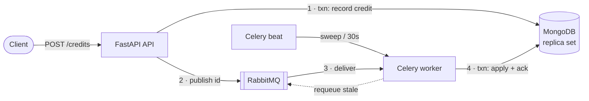

# Async Credit Processing Service: Design

## 1. Problem and goals

A client calls `POST /credits` with a `user_id` and an `amount`. The service answers `202 Accepted` straight away with a task id, and a Celery worker adds the amount to the user's balance later. A `status` field shows how far the credit has got. Because this is money, the design has three goals: **an accepted credit is never lost, no credit is ever applied twice, and no cent is lost to rounding.** The message queue only guarantees at-least-once delivery, so the design accepts that tasks may be delivered more than once and makes sure each credit still changes the balance only once.

Assumptions: credits are only accepted for users that already exist (otherwise `404`). Amounts are positive, at most 1,000,000.00, with at most two decimal places. There is a single currency. Authentication is out of scope.

## 2. Architecture

| Component | Role and key settings |
|---|---|
| **API** (FastAPI) | Validates the request, records the credit, publishes, and returns `202`. Handlers are synchronous because PyMongo and Celery publishing block; FastAPI runs them in its threadpool, so the event loop is never blocked. |
| **MongoDB** 8.2 | The source of truth. It runs as a replica set because multi-document transactions need one; locally that's a single node. |
| **RabbitMQ** | A durable queue with persistent messages and publisher confirms. I chose it over Redis because its ack and redelivery behaviour is explicit and the messages survive a restart. |
| **Celery worker** | `acks_late`, `reject_on_worker_lost`, `prefetch=1`: a message is only removed after the credit has been committed. |
| **Celery beat** | Schedules the sweeper. Exactly one instance runs. |

All three processes run from one codebase. The business logic in `services.py` imports neither FastAPI nor Celery, so the API, the worker and the tests all call the same code.

## 3. Data model

- **`users`**: `user_id` (unique), `balance` (Decimal128), `status`, `pending_credits`.
- **`credit_operations`**: `_id` (the task id), `user_id`, `amount`, `status` (`processing → processed | failed`), `attempts`, `error`, an optional `idempotency_key` with a request fingerprint, `created_at`, `processed_at` and `last_enqueued_at`.

Each credit gets its own record because a single `status` on the user can't describe two credits in flight at once. The per-credit record is the authoritative status. It also gives an audit trail and a task id that lasts. The user's `status` still follows the brief: it is computed in the same transaction that changes the balance. It reads `processing` while `pending_credits > 0`, and otherwise the outcome of the credit that finished last.

**Money** is a `Decimal` all the way through. A BSON codec stores it as `Decimal128`, and the API returns it as a string (`"150.00"`) so no client reads it as a binary float.

## 4. Request lifecycle

1. **Accept.** One transaction inserts the credit (`processing`), increments `pending_credits` and sets the user's status. An unknown user aborts the transaction and returns `404`. The API then publishes **only the credit id** and waits for RabbitMQ to confirm it. The Celery task id *is* the credit id, so there is only one identifier to track.
2. **Apply.** One transaction moves the credit from `processing` to `processed`, **but only if it is still `processing`**. It then sets `balance = ifNull(balance, 0) + amount` (which creates the field if it's missing), decrements `pending_credits` and recalculates the user's status. If the credit is already settled, the task does nothing.
3. **Read.** `GET /credits/{task_id}` returns the status, attempts and error. `GET /users/{user_id}` returns the balance.

## 5. Reliability: at-least-once delivery, each credit applied once

| Failure | What happens |
|---|---|
| Worker commits, then crashes before the ack | RabbitMQ redelivers the message. The conditional `processing → processed` step finds the credit already settled, so nothing changes. |
| Same message processed by two workers at once | Their transactions conflict on the same document. MongoDB retries the one that lost, which then sees `processed` and does nothing. |
| RabbitMQ down when the API publishes | The credit is already saved, so the API still returns `202` and logs the failure. The sweeper republishes the credit once it has been stuck for more than 120s. |
| Message lost after it was published | The same sweeper path picks it up. |
| Client retries the POST | The `Idempotency-Key` has a unique index and is stored with a fingerprint of the request. A retry with the same body gets the original task id; a different body gets `409`. When two duplicates arrive at the same time, the unique index decides which one wins. |
| Brief MongoDB failure (failover, network) | Celery retries up to 5 times with exponential backoff and full jitter. If the retries run out, the credit stays `processing` and the sweeper tries it again later. |
| User deleted before the credit is applied, or a message that keeps failing | After 10 attempts in total the credit is marked `failed`, the balance is left unchanged and `pending_credits` is decremented. |
| Many credits for one user at the same time | Every transaction writes the user document, so MongoDB serialises them through write conflicts and retries. The `$add` runs inside the update, so no update is lost. |

**Why there is no separate outbox.** The brief has the endpoint publish the task itself, so the API does exactly that. The credit document is already a durable record of what needs to happen, so it also serves as the outbox: the sweeper re-sends only the credits that are stuck. That saves a collection and a relay process. It also recovers messages that were lost *after* publishing, which a classic outbox doesn't cover.

## 6. Testing strategy

The tests run against **real MongoDB and RabbitMQ**, because transactions, write conflicts and redelivery are exactly what's being tested, and a mock would only repeat my own assumptions back to me. The tests use their own database and queue. End-to-end tests run a real Celery worker inside the test process and check the full path from HTTP request to updated balance. Each failure in the table above has a test. The concurrency tests send random amounts in parallel (40 threads, and an 8-thread worker) and assert the exact total. I checked that the key guard is really tested: removing the `processing` condition makes three tests fail. Unit tests cover parsing amounts, the backoff calculation and which errors count as transient. CI runs ruff, `mypy --strict` and all 66 tests (about 5s), then builds the images and runs a smoke test against the full stack.

## 7. Trade-offs and next steps

- **The user document is a write hotspot.** All credits for one user queue up on it. That's fine at this scale. For very busy accounts I'd move to append-only ledger entries with a balance computed from them.
- **The sweeper can republish a message that's still waiting in the queue.** That happens when the backlog is longer than `STALE_AFTER_SECONDS`. It's harmless because applying a credit is idempotent, but it's wasted work, so I'd alert on the number of requeues and tune the threshold.
- **A single beat instance** is a single point of failure, but only for recovery, not for normal processing. For high availability, add a leader lock or use RedBeat.
- **Production hardening:** a 3-node replica set, RabbitMQ quorum queues, authentication and authorisation, idempotency keys scoped per client with an expiry, and TLS with real credentials.
- **Metrics:** today there are structured logs with `task_id` on every event. Next I'd add queue depth, task latency and counts of failed and requeued credits, with alerts on failed credits.
